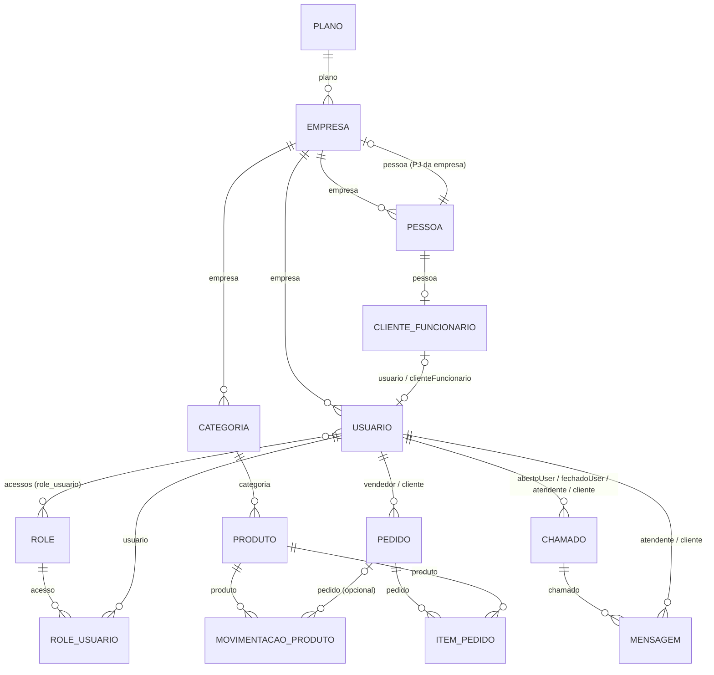

# Arquitetura — JDevERP Pro (back-end)

> Gerado na etapa 3 a partir do código. Complementa `CLAUDE.md` e `docs/analise-projeto.md`.

## 1. Visão geral

- API REST monolítica em Spring Boot 4.0.6 / Java 25, organizada por camada no pacote `br.com.jdeverp.pro`.
- ERP SaaS **multiempresa**: cada `Usuario` pertence a uma `Empresa`, e quase todos os dados de negócio são isolados por `empresa_id`.
- Autenticação JWT stateless; o token também fica gravado no usuário (`tokenSessao`) e é conferido a cada requisição.
- Persistência em PostgreSQL via Spring Data JPA, com um repository base próprio (`JpaJdevRepository`) que já filtra por empresa.
- Sem migrations: o schema é mantido pelo Hibernate (`ddl-auto=update`).

## 2. Módulos de negócio

Todos os controllers estão em `controller`, os services em `service`, os repositories em `repository` e as entidades em `model`.

| Módulo | Entidades | Services | Rota base | Escopo |
|---|---|---|---|---|
| SaaS / Assinatura | `Plano`, `Empresa` | `PlanoService`, `EmpresaService` | `/api/plano`, `/api/empresa` | global (`@IgnoreEmpresaId`) |
| Cadastros | `Pessoa`, `ClienteFuncionario` | `PessoaService`, `ClienteFuncionarioService` | `/api/pessoa`, `/api/clienteFuncionario` | por empresa |
| Acesso | `Usuario`, `Role`, `RoleUsuario` | `UsuarioService`, `UsuarioDetailsService`, `UsuarioLogadoService`, `JwtService`, `RoleService`, `RoleUsuarioService` | `/api/usuario`, `/api/role`, `/api/roleUsuario` | `Usuario` por empresa; `Role` global; `RoleUsuario` filtrado via `usuario.empresa` |
| Produtos / Estoque | `Categoria`, `Produto`, `MovimentacaoProduto` | `CategoriaService`, `ProdutoService`, `MovimentacaoProdutoService` | `/api/categoria`, `/api/produto`, `/api/movimentacaoProduto` | por empresa |
| Vendas | `Pedido`, `ItemPedido` | `PedidoService`, `ItemPedidoService` | `/api/pedido`, `/api/itemPedido` | por empresa |
| Suporte | `Chamado`, `Mensagem` | `ChamadoService`, `MensagemService` | `/api/chamado`, `/api/mensagem` | por empresa |

Enums por módulo:
- SaaS: `TipoPlano`.
- Cadastros: `TipoPessoa`, `TipoClienteFuncionario`.
- Estoque: `UnidadeMedida`, `TipoMovimentacaoProduto`.
- Vendas: `StatusPedido`, `TipoPedido`, `FormaPagamento`.
- Suporte: `TipoChamado`, `PrioridadeChamado`, `StatusChamado`.

## 3. Relacionamentos



Observações:
- Todas as entidades por empresa têm `@ManyToOne empresa` (omitido no diagrama para não poluir, exceto `Pessoa`, `Usuario` e `Categoria`).
- As relações são unidirecionais (lado "muitos"). Não há `@OneToMany` mapeado.
- `Usuario.clienteFuncionario` e `ClienteFuncionario.usuario` são duas FKs `@OneToOne` independentes, uma em cada tabela.
- A tabela `role_usuario` é mapeada **duas vezes**: pelo `@ManyToMany Usuario.acessos` (`@JoinTable`) e pela entidade `RoleUsuario`.
- `Cliente`/`vendedor`/`atendente` são `Usuario`, não `Pessoa` nem `ClienteFuncionario`.

## 4. Fluxo de uma requisição

```
HTTP  →  JwtFilter (OncePerRequestFilter)
           ├─ sem "Authorization: Bearer" → segue anônimo
           ├─ JwtService.validarToken(token)        (assinatura HMAC + expiração)
           ├─ JwtService.extrairLogin(token)
           ├─ UsuarioDetailsService.existsByTokenParaUser(token)   (token = Usuario.tokenSessao?)
           ├─ UsuarioDetailsService.loadUserByUsername(login)      (usuário liberado? empresa bloqueada?)
           └─ SecurityContext ← UsernamePasswordAuthenticationToken(UsuarioAutenticado, token, roles)
      →  SecurityFilterChain (SecurityConfig): permitAll / hasAuthority / authenticated
           └─ falha → JwtAuthenticationEntryPoint (401) / JwtAccessDeniedHandler (403)
      →  <Entidade>Controller
           └─ usuarioLogadoService.getEmpresaIdLogada()
      →  <Entidade>Service
           ├─ validações de negócio → MsgApiException
           └─ entidade.setEmpresa(usuarioLogadoService.getEmpresaLogada())
      →  <Entidade>Repository (extends JpaJdevRepository, impl JpaJdevRepositoryImpl)
           └─ @Query sempre com empresa.id (garantido por RepositoryEmpresaValidator na subida)
      →  PostgreSQL
Erros em qualquer camada (exceto dentro do filtro) → GlobalExceptionHandler → ResponseApi
```

## 5. Segurança

**Login** (`POST /api/usuario/login`, `UsuarioController` → `UsuarioService.login(LoginDTO)`):
1. Busca o usuário por login (`UsuarioRepository.buscaPorLogin`, `@IgnoreEmpresaId`).
2. Recusa usuário inexistente, não liberado (`liberado=false`) ou com empresa bloqueada (`Empresa.bloqueio`), todos com 401.
3. Confere a senha com BCrypt e chama `AuthenticationManager.authenticate`.
4. `JwtService.gerarToken`: subject = login, claims `usuarioId`, `empresaId`, `login`; expiração `jwt.expiration` (24h).
5. Grava o token em `Usuario.tokenSessao` (`updateTokenSessaoLogin`) e devolve `TokenDTO`.
   Como só um token fica gravado, **um novo login invalida o token anterior**.

**Roles:**
- Entidade `Role` (campo `acesso`, implementa `GrantedAuthority`), cadastrada via `/api/role`. O nome precisa começar com `ROLE_`.
- Associação usuário↔role: `RoleUsuario` (`/api/roleUsuario`) ou `Usuario.acessos`.
- Usadas no código: `ROLE_ADMIN` (`SecurityConfig`, `Usuario.idAdmin()`) e `ROLE_USER` (dada a todo usuário novo em `UsuarioService.salvar`).
- Checagem de admin no código: `UsuarioLogadoService.isAdmin()`, usada só em `EmpresaService` e `UsuarioService`.

**Rotas:**
- Pública: `/api/usuario/login`.
- `/api/admin/**` → `ROLE_ADMIN` (sem endpoints hoje).
- Todo o resto → autenticado. Não há `@PreAuthorize` em nenhum método.
- CORS liberado para qualquer origem (`SecurityConfig.corsConfigurationSource`).

## 6. Configuração

| Arquivo | Uso |
|---|---|
| `application.properties` | Só define `spring.profiles.active=${SPRING_PROFILES_JDEV_ERP_PRO:dev}` |
| `application-dev.properties` | Perfil de desenvolvimento: datasource PostgreSQL, Hikari, JPA (`ddl-auto=update`), JWT, porta 8081, context-path `/jdev-erp-pro-back-end-dev`, logs em `jdev-erp-pro-back-end-dev.log` |
| `application-prod.properties` | Perfil de produção, **idêntico ao dev** exceto `spring.application.name` |

- Não existe perfil de teste; os testes usam o perfil ativo (dev).
- Componentes por perfil: `config/ConfiguracaoProducao` (`@Profile("dev")`, só imprime no console).
- `config/PostgreSQLFunctionContributor` registra funções do PostgreSQL no Hibernate (ex.: `unaccent`, usada nas buscas por nome).
- Cache: `ConcurrentMapCacheManager` (`cacheJDevERPPRO`), declarado em `JDevERPPROApplication`.
- Time zone `America/Sao_Paulo` e locale `pt_BR` são definidos no `@PostConstruct` da aplicação.

## 7. Integrações externas

- **Nenhuma.** Não há clientes HTTP (`RestTemplate`/`RestClient`/`WebClient`), e-mail, filas, pagamentos nem NF-e.
- `@EnableScheduling` e `@EnableAsync` estão ativos, mas não existe nenhum `@Scheduled` nem `@Async`.
- Arquivos (`Empresa.logoMarca`, `Produto.imagem`, `Mensagem.arquivo`) são guardados como texto no banco; não há storage externo.
